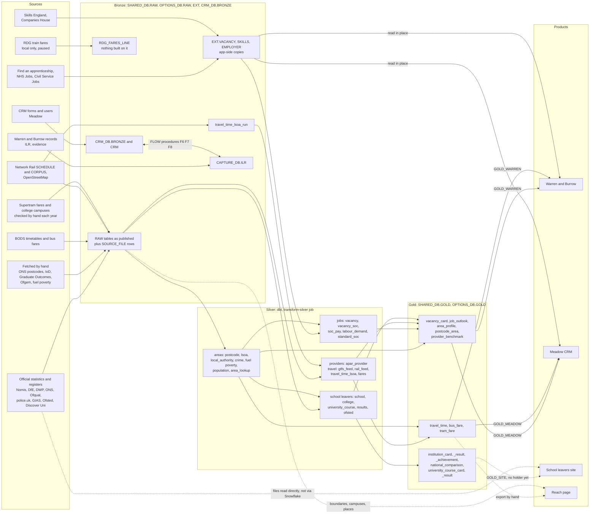

# The data journey

How data gets from each source into the apps, in plain English. Written
21 October 2026 from the repo and from dbt's lineage (`dbt/target/manifest.json`,
built 21 October 2026, 14:24), not from Snowflake: nothing here was checked
against live tables, so a number or a table name below is what the code says,
not what the account holds. Anything that looks wrong or missing is listed
under [Gaps and things that look wrong](#gaps-and-things-that-look-wrong);
none of it has been fixed.

## The short version

Every data set takes the same route (decisions 15, 16 and 21):

1. **Fetch.** A script downloads the file or calls the API. Hand-fetched sets
   are put in the data folder (`RAREBIT_DATA`) by a person first.
2. **Bronze.** `npm run load:data` (a numbered step, 1 to 50) loads the file
   as published into a `RAW` table, as `DATA_LOAD_USER`, with a `SOURCE_FILE`
   row (what, where from, version, licence) and a row in `OPS.JOB_RUN`.
   Nothing is changed or cleaned on the way in. Bronze tables are tagged
   (`check:tags --bronze`).
3. **Silver.** dbt cleans and joins bronze into tidy tables (one meaning per
   column, honesty rules applied, every column described and tagged). Built
   by the `transform-silver` job.
4. **Gold.** dbt shapes silver into the tables a product reads. Each gold
   table names its readers in `meta.readers`; Snowflake grants exactly those.
5. **The apps.** Warren and Burrow (the ILR and apprentice app, `ILR_APP_ROLE`),
   Meadow (the CRM, `CRM_APP_ROLE`) and the school leavers site (the options
   app) read gold, or in places read shared data directly (see the gaps).

Where the data lives: `SHARED_DB` (shared reference data: `RAW`, `EXT`,
`REF`, `SKILLS`, `SILVER`, `GOLD`, `OPS`, `FLOW`, `GOVERNANCE`), `OPTIONS_DB`
(the options site: `RAW`, `SILVER`, `GOLD`, `CLEAN`, `CONTENT`), `CRM_DB`
(`BRONZE`, `CRM`, `GOLD`), and `CAPTURE_DB` (Warren and Burrow's own records,
`ILR`, `ACCESS`, `TEST_BASELINE`).

## The whole flow

Solid lines are wired up in the code. Dotted lines are either not live yet
(no role holds the reader), run by hand, or bypass Snowflake; each is
explained below and in the gaps.

## When the jobs run

There is no clock time. A Windows scheduled task on Alan's laptop starts
`npm run jobs` (one **tick**) every 15 minutes, at log on and on unlocking.
A tick runs every job whose last success is older than its interval, one at
a time, in this order (`server/jobSchedule.js`, `JOB_ORDER`):

| Job | Interval | What it moves |
|---|---|---|
| `vacancies-full` | 24 hours | every Find an apprenticeship advert, to `EXT.VACANCY` |
| `vacancies-new` | 2 hours | adverts from the last day (a full run counts) |
| `companies-refresh` | 24 hours | Companies House, for Warren's employers |
| `skills` | 7 days | Skills England standards and KSBs, to `SHARED_DB.SKILLS` |
| `official-nomis` | 7 days | claimant count, ASHE pay by area, population |
| `official-api` | 7 days | DfE key stage 4, destinations, apprenticeship headlines |
| `official-statxplore` | 7 days | DWP Universal Credit, Work and Health Programme |
| `official-ons` | 7 days | ONS online job adverts, vacancies by industry |
| `official-ofqual` | 7 days | Ofqual register |
| `official-monthly` | 30 days | police.uk, provider register (APAR), NaPTAN, listed buildings, Wikidata places |
| `travel-monthly` | 30 days | travel times (needs 5.5 GB free, so the dev servers must be stopped) |
| `transform-silver` | 24 hours | dbt: silver and gold, tests, swap in |
| `website-links` | 24 hours | a seventh of the website links |

Order matters. Loads come first and `transform-silver` is last of the data
jobs, so one tick can fetch, load and then build silver and gold from what it
just loaded. `transform-silver` shares the `official` lock group, so it never
runs while an official load is open. A failed job is tried again no sooner
than an hour later. After sleep, the next tick runs each overdue job once.
Every run is a row in `SHARED_DB.OPS.JOB_RUN`; managers see overdue jobs on
their home page.

Silver and gold are built in `SILVER_STAGING` and `GOLD_STAGING`, tested, the
tags are checked, and only then is each table swapped into `SILVER` or
`GOLD`. If anything fails, live silver and gold stay as they were. After the
swap, 18 data metric functions are attached or refreshed (7 on silver, 11 on
gold); a missed expectation is a warning, not a failure.

## One section per source

### Official loads

**What:** the public statistics and registers: Nomis (claimant count, ASHE
pay, population), DfE (key stage 4, destinations, apprenticeship headlines,
16 to 18 performance, achievement rates, national comparisons), DWP
Stat-Xplore, ONS (online job adverts, VACS02), Ofqual, police.uk, the
provider register (APAR), NaPTAN, listed buildings, Wikidata places, GIAS,
Ofsted, Discover Uni and LEO.

**Bronze:** `RAW` tables, one per data set, in `SHARED_DB` (area and jobs
data) or `OPTIONS_DB` (school, college and university data), loaded by
`load:data` steps 3 to 40 as published, with `SOURCE_FILE` rows. The
`official-*` jobs call `scripts/fetch-official.js`, which fetches only what
is new, then runs the matching steps. Some sets are fetched by hand because
their addresses change with each release: the ONS postcode directory, Ofgem
price caps, fuel poverty and Graduate Outcomes (`docs/scheduling.md`). The
GIAS, Ofsted, performance and achievement-rate files are also downloaded into
`RAREBIT_DATA` rather than fetched by a job, as far as I could see.

**Silver:** `areas` (postcode, lsoa, local_authority, population, crime,
fuel poverty, area_lookup), `jobs` (labour_demand, soc_pay, standard_soc),
`school_leavers` (school, college_16_18, university_course and its outcomes,
Ofsted, performance results, achievement rates, national figures) and
`providers` (apar_provider).

**Gold:** `area_profile`, `postcode_area`, `job_outlook`, `provider_benchmark`
in `SHARED_DB.GOLD`; `institution_card`, `institution_result`,
`institution_achievement`, `national_comparison`, `university_course_card`,
`university_course_result` in `OPTIONS_DB.GOLD`. Small-number rules apply in
silver and gold (hide a figure based on under 10 people, take care under 30);
a gold test (`SHOWN_BASE_UNDER_10`) expects zero such rows.

**Reaches:** Warren (`postcode_area`, `job_outlook`, `provider_benchmark`),
Meadow (`area_profile`, `job_outlook`), and the school leavers site (the
`OPTIONS_DB.GOLD` tables, once something holds that reader role).

### Vacancies (Find an apprenticeship, NHS Jobs, Civil Service Jobs)

**What:** the Display Advert API v2; each run makes three passes (Find an
apprenticeship, then NHS, then Civil Service Jobs).

**Bronze:** every response goes unchanged to `SHARED_DB.RAW.FAA_VACANCY_PAGE`
(add-only). Each advert is cleaned to plain text and merged into
`SHARED_DB.EXT.VACANCY` by `VACANCYREFERENCE`; employer contact details stay
in RAW only. Runs as `DATA_LOAD_USER`. `vacancies-full` nightly, `vacancies-new`
every 2 hours. Occupation codes (`EXT.VACANCY_SOC`) come from `code:vacancies`.

**Silver and gold:** silver `vacancy` and `vacancy_soc` (read from `EXT`, with
the postcode lookup), then gold `vacancy_card` and `job_outlook` (which also
uses pay, labour demand and the SOC framework).

**Reaches:** Warren, Meadow and the school leavers site's readers. Meadow
and Warren also read `EXT.VACANCY` directly (`server/vacancies.js`,
`server/meadowPerson.js`).

### Skills England and Companies House

**What:** Skills England's standards and KSBs; Companies House records for
employers.

**Bronze and app-side:** `skills` weekly into `SHARED_DB.SKILLS`;
`companies-refresh` daily into `RAW` (every response, add-only) and the
employer's company columns. These are not dbt sources: the apps read them in
place (`server/ksbVersions.js`, `server/ilr/standards.js`,
`server/employers.js`). Silver's `standard_soc` uses the Skills England
occupation and standard-version tables.

### BODS (Bus Open Data Service)

**What:** the Yorkshire GTFS timetable feed, and bus fares (NeTEx XML) for
South Yorkshire's operators. OGL v3.0.

**Bronze:** `bods_gtfs_*` (feed info, routes, trips, stops, calendar, calendar
dates) via `load:data` 41; `bods_fares_dataset` and `bods_fares_netex` via
step 48. Both downloads start by hand: the GTFS zip is copied from
`RAREBIT_DATA` by `fetch.py`, and fares are fetched quarterly with
`fetch_bus_fares.py --fetch`.

**Silver:** `gtfs_feed`, `bus_fare_product`, `bus_fare_unmapped` (fares with
no product mapping), and the seed `bus_fare_product_map` (252 lines, checked
by hand).

**Gold:** `bus_fare`, and the GTFS feeds go into the travel-time compute
below. Readers: Warren, Meadow, site.

### Rail (Network Rail and OpenStreetMap)

**What:** Network Rail SCHEDULE full extract and CORPUS (licence `nr-open`)
and the OpenStreetMap extract.

**Bronze:** `nr_schedule_extract`, `nr_gtfs_*` (the rail GTFS built for the
chosen day), `osm_extract`, via `load:data` 41 and 44.

**Silver and gold:** silver `rail_feed`; gold `travel_time` joins the times
to LSOAs and both feeds.

**Travel times (the monthly job):** `travel-monthly` fetches the newest
inputs, clips the BODS feed to South Yorkshire plus 5 km, builds the rail
GTFS, loads (steps 41 and 44), and runs r5py (about an hour, 4.5 GB heap)
for bus, tram and train together plus bus-only, train-only and walking.
Results go to `SHARED_DB.RAW.TRAVEL_TIME_LSOA_RUN` (step 42). The next
`transform-silver` run turns them into silver `travel_time_lsoa` and gold
`travel_time` (860 LSOAs by 860; capped at 90 minutes). The day is the next
term-time Tuesday at least 14 days ahead.

**Reaches:** Warren, Meadow and the site (reader roles), and the reach page.

### Fares (Supertram, college campuses and the RDG train fares)

- **Supertram fares:** `scripts/fares/supertram-fares.csv`, checked by hand
  each January against Travel South Yorkshire's pages, loaded by step 49,
  silver `supertram_fare`, gold `tram_fare`.
- **RDG train fares:** the National Rail Data Portal fares feed 924, loaded
  as published by step 50 to `SHARED_DB.RAW.RDG_FARES_LINE` (24 files,
  9.8 million lines). Local only and paused: RDG says portal fares are for
  proof of concept or development work, and has not yet said whether a public
  app is covered. Nothing is built on it; the specification (RSPS5045) is
  still to be saved.
- **College campuses:** 26 campuses from the four South Yorkshire colleges'
  own pages (`scripts/reach/college-campuses.csv`, step 47, rechecked each
  October). They go straight from bronze into the reach export, not through
  dbt.

### CRM (Meadow)

**What:** leads, employers, contacts, pipelines, activities, placements,
form submissions.

**Where:** `CRM_DB.BRONZE` (form submissions exactly as received), `CRM_DB.CRM`
(the CRM's own tables), `CRM_DB.GOLD` (empty; reports are for later). No dbt
models run on `CRM_DB`. The CRM reads shared data in place (`REF`, `SKILLS`,
`EXT.VACANCY`, `ACCESS`), read-only, and has nothing in `CAPTURE_DB`.

**Crossing to Warren:** only through stored procedures in `SHARED_DB.FLOW`,
each call logged in `SHARED_DB.OPS.FLOW_RUN`: F6 hands a placed candidate
over to `ILR.ONBOARDING` (and creates the sign-in), F7 mirrors Warren's
onboarding status back into the CRM, F8 copies a won employer's contacts into
Warren. The data tags and the person record's anonymising are checked by
`check:tags --crm`.

### Warren and Burrow

**What:** the learner and ILR records, employers, sites, evidence and
portfolios, in `CAPTURE_DB.ILR`; sign-ins and organisations in
`SHARED_DB.ACCESS`.

**Direction:** these are written by the app (`ILR_APP_ROLE`), not loaded.
They are not bronze in the dbt sense. The ILR return is produced from them
(`server/ilr/`). Gold flows in: `GOLD_WARREN` gives Warren and Burrow
`postcode_area`, `vacancy_card`, `job_outlook`, `provider_benchmark`,
`travel_time`, `bus_fare` and `tram_fare`. The one standing exception is
that `SYSADMIN` also holds `ILR_APP_ROLE` (decision recorded 14 October
2026).

### The options app (school leavers site)

**What:** `~/school-leavers-app`, an Astro static site for students and
parents, with no accounts and no personal data.

**Its own pipeline:** `npm run import:institutions` builds
`data/institutions/<URN>.json` from the Explore education statistics API and
files in `RAREBIT_DATA` (GIAS, Ofsted, achievement rates). It does not read
Snowflake. In parallel, the same sources load to `OPTIONS_DB.RAW` and go through
silver to `OPTIONS_DB.GOLD`, and `npm run compare:gold-site` compares gold with
the site's own files field by field, read-only, as `TRANSFORM_USER`.

**Reaches:** the site gets its gold from nowhere yet: `OPTIONS_DB.GOLD_SITE`
and `SHARED_DB.GOLD_SITE` have no holder (`GOLD_HOLDERS` is empty).

### The reach page

**What:** `reach.astro` in the school leavers site, a map shading South
Yorkshire's LSOAs by travel time, with colleges, sixth forms and universities.
Local only, until the ODbL and map-tile questions in decision 19 are settled.

**How the data gets there:** by hand. `node scripts/reach/export.js` reads
gold `TRAVEL_TIME`, `RAW.ONS_LSOA_BOUNDARY`, `RAW.COLLEGE_CAMPUS`, silver
`POSTCODE`, GIAS and Discover Uni, and writes `data/reach/export/` (860 origin
files, boundaries, postcodes, places; not in git). `check-export.js` compares
every file with gold (5.9 million numbers). Then, in the site,
`npm run reach:data` copies the export into `public/reach-data/`. The page
makes no Snowflake call per click.

## Gaps and things that look wrong

Noted, not fixed. In rough order of how much they matter.

1. **The apps do not read gold.** Searching `server/` and `src/` for the gold
   table names (`VACANCY_CARD`, `JOB_OUTLOOK`, `TRAVEL_TIME`, `POSTCODE_AREA`,
   `PROVIDER_BENCHMARK`, `AREA_PROFILE`, `BUS_FARE`, `TRAM_FARE`) finds nothing.
   `GOLD_WARREN` and `GOLD_MEADOW` are granted to `ILR_APP_ROLE` and
   `CRM_APP_ROLE`, but today Warren and Meadow read `SHARED_DB.EXT.VACANCY`,
   `REF.POSTCODE`, `REF.SIC2007` and `SKILLS` directly. The gold-to-app step in
   the diagram is permissions only, not live code.
2. **Two postcode copies.** The apps use `SHARED_DB.REF.POSTCODE`
   (`server/vacancies.js`); the dbt silver `postcode` is built from the bronze
   ONS postcode directory. They can disagree, and nothing compares them.
3. **The options site bypasses Snowflake.** `import:institutions` reads the
   API and files directly, and `OPTIONS_DB.GOLD_SITE` has no holder, so the
   standing rule (everything goes through Snowflake) holds for the loads but
   not for what the site shows. `compare:gold-site` is the only bridge, and it
   is a manual check with expected differences (a 2021/22 apprenticeship year,
   about 2 websites).
4. **The reach export is not scheduled.** `travel-monthly` loads new times and
   `transform-silver` builds gold, but `export.js`, `check-export.js` and
   `reach:data` are run by hand "after each monthly refresh". Until they are,
   the reach page shows the previous month's times. It also reads
   `RAW.ONS_LSOA_BOUNDARY` and `RAW.COLLEGE_CAMPUS` directly, skipping silver
   and gold, so those have no dbt tests, tags-in-silver or data metric
   functions.
5. **F7's "nightly reconcile" has no job.** `sql/flow_01_f6_f7_f8.sql` says a
   null user ID is "the scheduler's nightly reconcile", but `JOB_SCHEDULE` and
   `JOB_ORDER` have no such job and the only callers I found are Warren and
   `scripts/journeys/run.js`. Either it is planned and not built, or it was
   dropped.
6. **CRM lead retention is not scheduled.** `docs/before-real-data.md` lists
   the anonymising procedure as still to decide; no job runs it. Likewise the
   2-year clearing of `EXT.VACANCY` and RAW pages needs an admin job that does
   not exist.
7. **`docs/scheduling.md` is out of date.** Its opening line says ten jobs, an
   eleventh and a twelfth; the table lists thirteen. "The first tick ... up to
   all four, about 30 minutes" predates the official, travel, silver and link
   jobs.
8. **Several "scheduled" inputs start by hand.** BODS timetables (copied from
   `RAREBIT_DATA`), BODS fares (quarterly), Supertram fares (yearly), college
   campuses (yearly), and the ONS postcode directory, IoD, Graduate Outcomes,
   Ofgem and fuel poverty tables. `bus_fare_not_stale` is the only guard I
   saw for this; nothing warns when the others age.
9. **One laptop runs everything.** Jobs only run while it is on, nothing sends
   an alert when a job is overdue, and `travel-monthly` needs the dev servers
   stopped to start. All known (`docs/before-real-data.md`), but it is the
   largest operational risk in the journey.
10. **Bronze with nothing built on it.** `RDG_FARES_LINE` is deliberate (paused).
    `NAPTAN_STOP` is a dbt source and is used by a test and the rail GTFS
    builder, but I found no silver model that reads it.
11. **A loop through `website_link`.** Silver reads `EXT.WEBSITE_LINK`, and
    the link job reads its URLs from silver. It works (a link's result is a
    day behind), but a new URL only gets checked after one `transform-silver`
    run and is then hidden after two failed weekly checks.
12. **dbt docs were not generated.** `dbt docs generate` connects to Snowflake
    and writes files, so I read `manifest.json` instead. It was built before
    this document and shows `*_STAGING` schemas as the build targets (as
    expected); anything added since is missing here.
13. **Snowflake itself was not touched.** The table counts, file counts and
    "all rows match" claims in the repo's notes (for example 24 files,
    9,821,613 lines for the fares load) are quoted, not re-checked.
